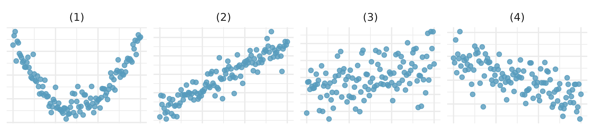
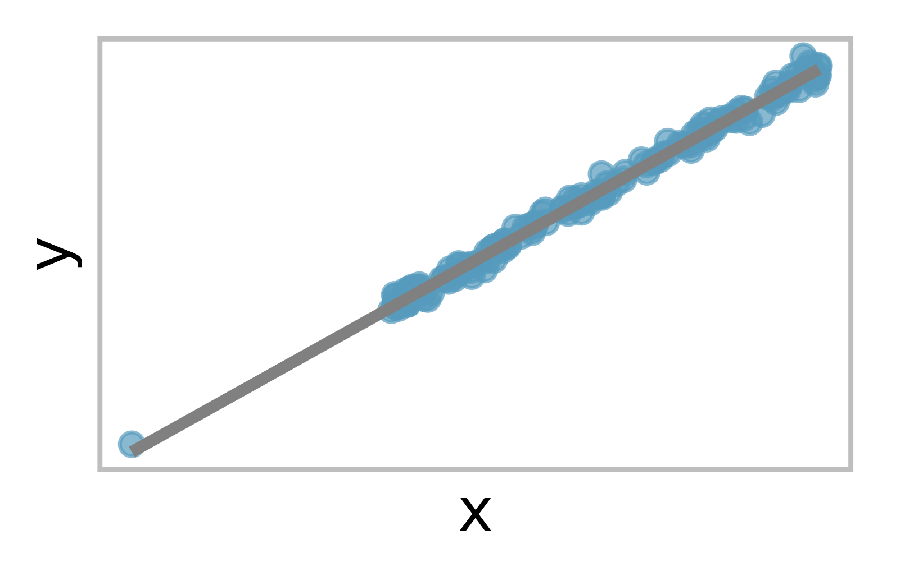

```{r}
#| label: load-packages
#| message: false
library(tidyverse)
library(tidymodels)
library(openintro)
library(scales)
theme_set(theme_minimal(base_size = 12))
```

```{r}
#| label: blizzard-data-prep
blizzard_salary <- blizzard_salary |>
  mutate(
    annual_salary = case_when(
      salary_type == "week" ~ current_salary * 52,
      salary_type == "hour" ~ current_salary * 40 * 52,
      TRUE ~ current_salary
    ),
    performance_rating = if_else(
      performance_rating == "Developing",
      "Poor",
      performance_rating
    )
  ) |>
  filter(salary_type != "week") |>
  mutate(
    salary_type = if_else(salary_type == "hour", "Hourly", "Salaried")
  ) |>
  filter(!is.na(annual_salary)) |>
  select(percent_incr, salary_type, annual_salary, performance_rating)
```

::: callout-note
Suggested answers can be found [here](/exam-review/exam-2-review-A.html), but resist the urge to peek before you go through it yourself.
:::

## Reference materials

The following resources will be made available in the exam:

- a scientific calculator that looks like this:


- [Hello Data Science](https://hellodata.science/)

- [Introduction to Modern Statistics 2e](https://openintrostat.github.io/ims/)

- [R for Data Science 2e](https://r4ds.hadley.nz/)

- Formulas:

$$
\widehat{p}
=
\frac{e^{b_0+b_1x+\cdots +b_mx_m}}{1+e^{b_0+b_1x+\cdots +b_mx_m}}
$$


$$
\log\left(\frac{\widehat{p}}{1-\widehat{p}}\right)
=
b_0+b_1x+\cdots+b_mx_m
$$
$$FNR = \dfrac{FN}{FN+TP}$$
$$FPR = \dfrac{FP}{FP+TN}$$
$$TPR = \dfrac{TP}{FN+TP}$$
$$TNR = \dfrac{TN}{FP+TN}$$


## Blizzard salaries

In 2020, employees of Blizzard Entertainment circulated a spreadsheet to anonymously share salaries and recent pay increases amidst rising tension in the video game industry over wage disparities and executive compensation.
(Source: [Blizzard Workers Share Salaries in Revolt Over Pay](https://www.bloomberg.com/news/articles/2020-08-03/blizzard-workers-share-salaries-in-revolt-over-wage-disparities))

The name of the data frame used for this analysis is `blizzard_salary` and the variables are:

-   `percent_incr`: Raise given in July 2020, as percent increase with values ranging from 0 (no increase) to 21.5 (21.5% increase)

-   `salary_type`: Type of salary, with levels `Hourly` and `Salaried`

-   `annual_salary`: Annual salary, in USD, with values ranging from \$1 to \$216,856.

-   `performance_rating`: Most recent review performance rating, with levels `Poor`, `Successful`, `High`, and `Top`.
    The `Poor` level is the lowest rating and the `Top` level is the highest rating.

The first ten rows of `blizzard_salary` are shown below:

```{r}
blizzard_salary |>
  select(percent_incr, salary_type, annual_salary, performance_rating)
```

### Question 1

You fit a model for predicting raises (`percent_incr`) from salaries (`annual_salary`). We'll call this model `raise_1_fit`. A tidy output of the model is shown below.

```{r}
#| label: raise-salary-fit
raise_1_fit <- linear_reg() |>
  fit(percent_incr ~ annual_salary, data = blizzard_salary)

tidy(raise_1_fit)
```

Which of the following is the best interpretation of the slope coefficient?

a.  For every additional \$1,000 of annual salary, the model predicts the raise to be higher, on average, by 1.55%.
b.  For every additional \$1,000 of annual salary, the raise goes up by 0.0155%.
c.  For every additional \$1,000 of annual salary, the model predicts the raise to be higher, on average, by 0.0155%.
d.  For every additional \$1,000 of annual salary, the model predicts the raise to be higher, on average, by 1.87%.

### Question 2

You then fit a model for predicting raises (`percent_incr`) from salaries (`annual_salary`) and performance ratings (`performance_rating`). We'll call this model `raise_2_fit`. Which of the following is definitely true based on the information you have so far?

a.  Intercept of `raise_2_fit` is higher than intercept of `raise_1_fit`.
b.  Slope of `raise_2_fit` is higher than RMSE of `raise_1_fit`.
c.  Adjusted $R^2$ of `raise_2_fit` is higher than adjusted $R^2$ of `raise_1_fit`.
d.  $R^2$ of `raise_2_fit` is higher than $R^2$ of `raise_1_fit`.



### Question 3

The tidy model output for the `raise_2_fit` model you fit is shown below.

```{r}
#| label: raise-salary-rating-fit
raise_2_fit <- linear_reg() |>
  fit(percent_incr ~ annual_salary + performance_rating, data = blizzard_salary)

tidy(raise_2_fit)
```

When your teammate sees this model output, they remark 

> "The coefficient for `performance_ratingSuccessful` is negative. That's weird. I guess it means that people who get successful performance ratings get lower raises." 

How would you respond to your teammate?

::: {.content-visible when-format="pdf"}
$\vspace{1.5cm}$
:::

### Question 4

Ultimately, your teammate decides they don't like the negative slope coefficients in the model output you created (not that there's anything wrong with negative slope coefficients!), does something else, and comes up with the following model output.

```{r}
blizzard_salary <- blizzard_salary |>
  mutate(
    performance_rating = fct_relevel(
      performance_rating,
      "Poor",
      "Successful",
      "High",
      "Top"
    )
  )

raise_2_fit <- linear_reg() |>
  fit(percent_incr ~ annual_salary + performance_rating, data = blizzard_salary)

tidy(raise_2_fit)
```

Unfortunately they didn't write their code in a Quarto document, instead just wrote some code in the Console and then lost track of their work. They remember using the `fct_relevel()` function and doing something like the following:

```{r}
#| eval: false
#| echo: true
blizzard_salary <- blizzard_salary |>
  mutate(performance_rating = fct_relevel(performance_rating, ___))
```

What should they put in the blanks to get the same model output as above?

a.  "Poor", "Successful", "High", "Top"
b.  "Successful", "High", "Top"
c.  "Top", "High", "Successful", "Poor"
d.  Poor, Successful, High, Top

### Question 5

Suppose we fit a model to predict `percent_incr` from `annual_salary` and `salary_type`. A tidy output of the model is shown below.

```{r}
#| label: raise-salary-type-fit
raise_3_fit <- linear_reg() |>
  fit(percent_incr ~ annual_salary + salary_type, data = blizzard_salary)

tidy(raise_3_fit)
```

Which of the following visualizations represents this model? Explain your reasoning.

```{r}
#| label: fig-raise-salary-type
#| warning: false
#| layout-ncol: 2
#| fig-cap: |
#|   Visualizations of the relationship between percent increase, annual
#|   salary, and salary type
#| fig-subcap:
#|   - Option 1
#|   - Option 2
#|   - Option 3
#|   - Option 4
ggplot(
  blizzard_salary,
  aes(x = annual_salary, y = percent_incr, color = salary_type)
) +
  geom_point(aes(shape = salary_type), alpha = 0.5, size = 2) +
  geom_smooth(
    aes(linetype = salary_type),
    method = "lm",
    se = FALSE,
    fullrange = TRUE,
    linewidth = 1.5
  ) +
  labs(
    x = "Annual salary",
    y = "Percent increase",
    color = "Salary type",
    linetype = "Salary type",
    shape = "Salary type"
  ) +
  scale_x_continuous(labels = label_dollar()) +
  scale_y_continuous(labels = label_percent(scale = 1)) +
  scale_color_manual(values = c("cornflowerblue", "black")) +
  theme(legend.position = "top")

ggplot(
  blizzard_salary,
  aes(x = annual_salary, y = percent_incr, color = salary_type)
) +
  geom_point(aes(shape = salary_type), alpha = 0.5, size = 2) +
  geom_smooth(
    aes(linetype = salary_type),
    se = FALSE,
    fullrange = TRUE,
    linewidth = 1.5
  ) +
  labs(
    x = "Annual salary",
    y = "Percent increase",
    color = "Salary type",
    linetype = "Salary type",
    shape = "Salary type"
  ) +
  scale_x_continuous(labels = label_dollar()) +
  scale_y_continuous(labels = label_percent(scale = 1)) +
  scale_color_manual(values = c("cornflowerblue", "black")) +
  theme(legend.position = "top")

raise_3_lines <- tibble(
  salary_type = c("Hourly", "Salaried"),
  slope = 0.0000137
)

ggplot(
  blizzard_salary,
  aes(x = annual_salary, y = percent_incr, color = salary_type)
) +
  geom_point(aes(shape = salary_type), alpha = 0.5, size = 2) +
  geom_abline(
    data = raise_3_lines |> mutate(intercept = c(1.24, 1.24 + 0.913)),
    aes(
      intercept = intercept,
      slope = slope,
      color = salary_type,
      linetype = salary_type
    ),
    linewidth = 1.5
  ) +
  labs(
    x = "Annual salary",
    y = "Percent increase",
    color = "Salary type",
    linetype = "Salary type",
    shape = "Salary type"
  ) +
  scale_x_continuous(labels = label_dollar()) +
  scale_y_continuous(labels = label_percent(scale = 1)) +
  scale_color_manual(values = c("cornflowerblue", "black")) +
  theme(legend.position = "top")

ggplot(
  blizzard_salary,
  aes(x = annual_salary, y = percent_incr, color = salary_type)
) +
  geom_point(aes(shape = salary_type), alpha = 0.5, size = 2) +
  geom_abline(
    data = raise_3_lines |> mutate(intercept = c(1.24 + 0.913, 1.24)),
    aes(
      intercept = intercept,
      slope = slope,
      color = salary_type,
      linetype = salary_type
    ),
    linewidth = 1.5
  ) +
  labs(
    x = "Annual salary",
    y = "Percent increase",
    color = "Salary type",
    linetype = "Salary type",
    shape = "Salary type"
  ) +
  scale_x_continuous(labels = label_dollar()) +
  scale_y_continuous(labels = label_percent(scale = 1)) +
  scale_color_manual(values = c("cornflowerblue", "black")) +
  theme(legend.position = "top")
```

::: {.content-visible when-format="pdf"}

:::



### Question 6

When building a model to predict `percent_incr`, what
is the main reason to split this data into training and testing sets?



# Movies

The data for this part comes from the Internet Movie Database (IMDB). Specifically, the data are a random sample of movies released between 1980 and 2020.

```{r}
#| label: load-data
#| message: false
movies <- read_csv("data/movies.csv")
```

The name of the data frame used for this analysis is `movies`, and it contains the variables shown in @tbl-data-dictionary.

\setcounter{table}{0}

| Variable          | Description                                                             |
|----------------------|--------------------------------------------------|
| `name`            | name of the movie                                                       |
| `rating`          | rating of the movie (R, PG, etc.)                                       |
| `genre`           | main genre of the movie.                                                |
| `runtime`         | duration of the movie                                                   |
| `year`            | year of release                                                         |
| `release_date`    | release date (YYYY-MM-DD)                                               |
| `release_country` | release country                                                         |
| `score`           | IMDB user rating                                                        |
| `votes`           | number of user votes                                                    |
| `director`        | the director                                                            |
| `writer`          | writer of the movie                                                     |
| `star`            | main actor/actress                                                      |
| `country`         | country of origin                                                       |
| `budget`          | the budget of a movie (some movies don't have this, so it appears as 0) |
| `gross`           | revenue of the movie                                                    |
| `company`         | the production company                                                  |

: Data dictionary for `movies` {#tbl-data-dictionary tbl-colwidths="\[20,80\]"}

The first thirty rows of the `movies` data frame are shown in @tbl-data, with variable types suppressed (since we'll ask about them later).



```{r}
#| echo: false
movies_to_mark <- c("Blue City", "Rang De Basanti", "Winter Sleep")

movies <- movies |>
  mutate(
    mark = if_else(name %in% movies_to_mark, TRUE, FALSE),
    rating = case_when(
      rating == "TV-PG" ~ "PG",
      rating == "Unrated" ~ "Not Rated",
      is.na(rating) ~ "Not Rated",
      .default = rating
    ),
    rating = fct_relevel(rating, "G", "PG", "PG-13", "R", "NC-17", "Not Rated")
  ) |>
  arrange(desc(mark)) |>
  relocate(
    name,
    score,
    runtime,
    genre,
    rating,
    release_country,
    release_date,
    budget,
    gross,
    votes,
    year,
    director,
    writer,
    star,
    company,
    country
  )
```

```{=tex}
\begin{landscape}
```

::: {#tbl-data}
First 30 rows of `movies`, with variable types suppressed.

```{r}
#| echo: false
options(
  dplyr.print_min = 30,
  pillar.min_chars = 13,
  pillar.width = 80,
  pillar.sigfig = 6
)

format(movies |> select(!c(mark)))[-3L] |>
  str_remove_all(" <.*?>") |>
  cat(sep = "\n")

options(
  dplyr.print_min = 10,
  pillar.min_chars = 8,
  pillar.width = 80,
  pillar.sigfig = 3
)
```

:::

```{=tex}
\end{landscape}
\clearpage
```




## Score vs. runtime

In this part, we fit a model predicting `score` from `runtime` and name it `score_runtime_fit`.

```{r}
#| echo: true
score_runtime_fit <- linear_reg() |>
  fit(score ~ runtime, data = movies)
```


@fig-score-runtime visualizes the relationship between `score` and `runtime` as well as the linear model for predicting `score` from `runtime`. The first three movies in @tbl-data are labeled in the visualization as well. Answer all questions in this part based on @fig-score-runtime.

```{r}
#| label: fig-score-runtime-prep
#| echo: false
movies <- movies |>
  mutate(
    runtime = parse_number(runtime),
    shape1 = case_when(
      name == movies_to_mark[1] ~ "circle",
      name == movies_to_mark[2] ~ "square",
      name == movies_to_mark[3] ~ "triangle",
      .default = "circle"
    ),
    shape2 = case_when(
      name == movies_to_mark[1] ~ "circle open",
      name == movies_to_mark[2] ~ "square open",
      name == movies_to_mark[3] ~ "triangle open",
      .default = NA
    ),
    color = if_else(mark, "black", "gray50"),
    alpha = if_else(mark, 1, 0.5)
  )
```

```{r}
#| label: fig-score-runtime
#| fig-cap: Scatterplot of `score` vs. `runtime` for `movies`.
#| echo: false
#| message: false
#| fig-asp: 0.5
#| fig-width: 6.5
ggplot(movies, aes(x = runtime, y = score)) +
  geom_point(aes(shape = shape1, color = color, alpha = alpha)) +
  geom_smooth(method = "lm", se = FALSE, color = "black") +
  scale_shape_identity() +
  scale_alpha_identity() +
  scale_color_identity() +
  geom_point(
    data = movies |> filter(mark),
    aes(shape = shape2),
    size = 3
  ) +
  geom_label(
    data = movies |> filter(mark),
    aes(label = name),
    size = 3,
    nudge_x = 1,
    nudge_y = c(-0.4, -0.4, 0.4)
  ) +
  scale_x_continuous(breaks = seq(80, 240, 20))
```



### Question 7

Which of the following is the best guess for the correlation between `runtime`
and `score`?

a. $r = -0.83$
b. $r = -0.43$
c. $r=-0.13$
d.  $r=0.03$
e.  $r=0.43$
f.  $r=0.93$
g.  $r=1.83$


### Question 8

Based on this model, order the three labeled movies in @fig-score-runtime in decreasing order of the magnitude (absolute value) of their residuals.

a.  Winter Sleep \> Rang De Basanti \> Blue City

b.  Winter Sleep \> Blue City \> Rang De Basanti

c.  Rang De Basanti \> Winter Sleep \> Blue City

d.  Blue City \> Winter Sleep \> Rang De Basanti

e.  Blue City \> Rang De Basanti \> Winter Sleep



### Question 9

```{r}
#| include: false
score_runtime_rsq <- round(glance(score_runtime_fit)$r.squared * 100, 0)
```

The R-squared for the model visualized in @fig-score-runtime is `{r} score_runtime_rsq`%. Which of the following is the [**best**]{.underline} interpretation of this value?

a.  `{r} score_runtime_rsq`% of the variability in movie runtimes is explained by their scores.

b.  `{r} score_runtime_rsq`% of the variability in movie scores is explained by their runtimes.

c.  The model accurately predicts scores of `{r} score_runtime_rsq`% of the movies in this sample.

d.  The model accurately predicts scores of `{r} score_runtime_rsq`% of all movies.

e.  The correlation between scores and runtimes of movies is `{r} score_runtime_rsq / 100`.

## Score vs. runtime or year

The visualizations below show the relationship between `score` and `runtime` as well as `score` and `year`, respectively. Additionally, the lines of best fit are overlaid on the visualizations.

```{r}
#| layout-ncol: 2
#| echo: false
#| message: false
ggplot(movies, aes(x = runtime, y = score)) +
  geom_point(alpha = 0.5, color = "gray40") +
  geom_smooth(method = "lm", se = FALSE, color = "black", linewidth = 1.2)

ggplot(movies, aes(x = year, y = score)) +
  geom_point(alpha = 0.5, color = "gray40") +
  geom_smooth(method = "lm", se = FALSE, color = "black", linewidth = 1.2)
```

The correlation coefficients of these relationships are calculated below, though some of the code and the output are missing. Answer all questions in this part based on the code and output shown below.

```{r}
#| include: false
movies |>
  summarize(
    r_score_runtime = cor(runtime, score),
    r_score_year = cor(year, score)
  )
```

```{r}
#| eval: false
#| echo: true
movies |>
  __blank_1__(
    r_score_runtime = cor(runtime, score),
    r_score_year = cor(year, score)
  )
```

```         
# A tibble: 1 × 2
  r_score_runtime r_score_year
            <dbl>        <dbl>
1           0.434 __blank_2__       
```

### Question 10

Which of the following goes in `__blank_1__`?

a.  `summarize`

b.  `mutate`

c.  `group_by`

d.  `arrange`

e.  `filter`

### Question 11

What can we say about the value that goes in `__blank_2__`?

a.  `NA`

b.  A value between 0 and 0.434.

c.  A value between 0.434 and 1.

d.  A value between 0 and -0.434.

e.  A value between -1 and -0.434.



## Score vs. runtime and rating

In this part, we fit a model predicting `score` from `runtime` and `rating` (categorized as G, PG, PG-13, R, NC-17, and Not Rated), and name it `score_runtime_rating_fit`.

```{r}
score_runtime_rating_fit <- linear_reg() |>
  fit(score ~ runtime + rating, data = movies)
```

The model output for `score_runtime_rating_fit` is shown in @tbl-score-runtime-rating-tidy. Answer all questions in this part based on @tbl-score-runtime-rating-tidy.

```{r}
#| label: tbl-score-runtime-rating-tidy
#| tbl-cap: Regression output for `score_runtime_rating_fit`.
#| echo: false
tidy(score_runtime_rating_fit) |>
  knitr::kable(digits = 3)
```

\vspace{1cm}

### Question 12

Which of the following is [**TRUE**]{.underline} about the intercept of `score_runtime_rating_fit`? **Select all that are true.**

a.  Keeping runtime constant, G-rated movies are predicted to score, on average, 4.525 points.

b.  Keeping runtime constant, movies without a rating are predicted to score, on average, 4.525 points.

c.  Movies without a rating that are 0 minutes in length are predicted to score, on average, 4.525 points.

d.  All else held constant, movies that are 0 minutes in length are predicted to score, on average, 4.525 points.

e.  G-rated movies that are 0 minutes in length are predicted to score, on average, 4.525 points.



### Question 13

Which of the following is the [**best**]{.underline} interpretation of the slope of `runtime` in `score_runtime_rating_fit`?

a.  All else held constant, as runtime increases by 1 minute, the score of the movie increases by 0.021 points.

b.  For G-rated movies, all else held constant, as runtime increases by 1 minute, the score of the movie increases by 0.021 points.

c.  All else held constant, for each additional minute of runtime, movie scores will be higher by 0.021 points on average.

d.  G-rated movies that are 0 minutes in length are predicted to score 0.021 points on average.

e.  For each higher level of rating, the movie scores go up by 0.021 points on average.

### Question 14

Fill in the blank:

> R-squared of `score_runtime_rating_fit` (the model predicting `score` from `runtime` and `rating`) \_\_\_\_\_\_\_\_\_ the R-squared of the model `score_runtime_fit` (for predicting `score` from `runtime` alone).

a.  is less than

b.  is equal to

c.  is greater than

d.  cannot be compared (based on the information provided) to

e.  is both greater than and less than



### Question 15

The model `score_runtime_rating_fit` (the model predicting `score` from `runtime` and `rating`) can be visualized as parallel lines for each level of `rating`. Which of the following is the equation of the line for R-rated movies?

a.  $\widehat{score} = (4.525 - 0.257) + 0.021 \times runtime$

b.  $score = (4.525 - 0.257) + 0.021 \times runtime$

c.  $\widehat{score} = 4.525 + (0.021 - 0.257) \times runtime$

d.  $score = 4.525 + (0.021 - 0.257) \times runtime$

e.  $\widehat{score} = (4.525 + 0.021) - 0.257 \times runtime$

## Question 16

Answer the following based on @tbl-score-runtime-rating-tidy.

```{r}
#| include: false
score_runtime_glance <- glance(score_runtime_fit)
score_runtime_rating_glance <- glance(score_runtime_rating_fit)
```

a.  Interpret the coefficient for `ratingR` in the context of the data.

b.  The R-squared of `score_runtime_fit` (predicting `score` from `runtime` alone) is `{r} round(score_runtime_glance$r.squared, 3)` and the R-squared of `score_runtime_rating_fit` (predicting `score` from `runtime` and `rating`) is `{r} round(score_runtime_rating_glance$r.squared, 3)`.
    The adjusted R-squared values of these models are `{r} round(score_runtime_glance$adj.r.squared, 3)` and `{r} round(score_runtime_rating_glance$adj.r.squared, 3)`, respectively.
    Your friend says, "R-squared went up when we added `rating`, so `rating` must be a useful predictor of score." Which statistic should be used to compare these two models?
    Based on that statistic, which model would you choose, and why?

::: {.content-visible when-format="typst"}
```{=typst}
#v(2cm)
```
:::

# Miscellaneous

## Question 17

Define the term "parsimonious model".

::: {.content-visible when-format="typst"}
```{=typst}
#v(2cm)
```
:::

## Question 18

In order to predict the amount a taxi rider tipped (in dollars) based on the
day of the week of the taxi ride, the time of day of the ride, and the ride
distance, you could build this type of model:

a. simple linear regression

b. multiple linear regression

c. logistic regression

d. ROC curve

## Question 19

The odds of the Roadrunners winning tomorrow's basketball game are 4 to 1. What
is the probability the Roadrunners will win the game?

## Question 20

Match each correlation to the corresponding scatterplot.


a. $r = -0.7$

b. $r = 0.45$

c. $r = 0.06$

d. $r = 0.92$

## Question 21

The following scatterplot has an outlier in the lower left corner. Which of the following are true about the outlier?
Select all that apply.

{width=300}

a. The point is outlying in the x direction.

b. The point is outlying in the y direction.

c. The point is influential.



# Spam filter

The data from this part come from incoming emails in David Diez's (one of the authors of the OpenIntro textbooks) Gmail account for the first three months of 2012. All personally identifiable information has been removed.

The name of the data frame used for this analysis is `email`.
The variables we'll use in this analysis are

-   `spam`: 1 if the email is spam, 0 otherwise
-   `dollar`: number of times a dollar sign or the word “dollar” appeared in the email

A logistic regression model was fit to predict whether an email is spam or not,
based on the number of times a dollar sign or the word “dollar” appeared in the email.

The model output is shown below:

```{r}
spam_dollar_fit <- logistic_reg() |>
  fit(spam ~ dollar, data = email)

tidy(spam_dollar_fit)
```

## Question 22

Partial code for producing the model (and its output) is given below.
Which of the following goes in the blank on line 2?


```{r}
#| eval: false
#| echo: true
#| code-line-numbers: true
spam_dollar_fit <- logistic_reg() |>
  fit(____, data = email)

tidy(spam_dollar_fit)
```


a.  `dollar ~ spam`

b.  `spam ~ dollar`

c.  `log(dollar) ~ spam`

d.  `spam ~ log(dollar)`


## Question 23

Based on the model output above for `spam_dollar_fit`, find the predicted
probability that an email containing 5 dollar signs is spam. Round to 3 decimal places.

## Question 24

What is the meaning of a false negative in this example?

a. A spam email was classified as spam.
b. A spam email was classified as not spam.
c. A not-spam email was classied as spam.
d. A not-spam email was classified as not spam.

## Question 25

Which of the following is the best interpretation of the coefficient of `dollar` in `spam_dollar_fit`?

a. For each additional dollar sign or word "dollar", the probability of spam decreases by 0.0564.
b. For each additional dollar sign or word "dollar", the log-odds of spam decrease by 0.0564.
c. For each additional dollar sign or word "dollar", the odds of spam decrease by 0.0564.
d. For each additional dollar sign or word "dollar", the probability of spam decreases by 5.64%.

## Question 26

The model `spam_dollar_fit` was used to classify a new email as spam or not.
The augmented dataframe showing predicted probabilities is below:

```{r}
tibble(.pred_0 = 0.43, .pred_1 = 0.57)
```

Using a threshold of 0.6, how would this email be classified?

a. Spam
b. Not spam
c. Partially spam
d. Cannot be determined

## Question 27

A new model `spam_fit2` was fit (using additional predictors) and was used to
classify each email in the `email`
dataset as spam or not spam. The predictions were checked and tallied. The code
and its output are shown below:
```{r}
spam_fit2 <- logistic_reg() |>
  fit(
    spam ~  dollar + winner + urgent_subj + num_char, 
    data = email
  )
```


```{r}
#| echo: true
augment(spam_fit2, new_data = email) |>
  count(spam, .pred_class)
```

Calculate the true positive rate of the model, rounded to 3 decimal places.

## Question 28

Suppose you increased the decision threshold. Which of the following are true?
Select all that apply.

a. The true positive rate would increase or stay the same.
b. The true positive rate would decrease or stay the same.
c. The area under the ROC curve would increase.
d. The model may predict "spam" less often.



## Question 29

The data is split into training and testing sets, and two new models for predicting `spam` are created.


```{r}
#| echo: true
set.seed(1234)
email_split <- initial_split(email, prop = 0.7)
email_training <- training(email_split)
email_testing <- testing(email_split)
```

The first model is fit predicting `spam` from `dollar`, `winner` (indicating whether "winner" appeared in the email: `"no"` or `"yes"`), and `urgent_subj` (whether the word "urgent" is in the subject of the email: `0` or `1`).
We will call this model Model A (`email_fit_A`).

```{r}
#| echo: true
email_fit_A <- logistic_reg() |>
    fit(spam ~ dollar + winner + urgent_subj, data = email_training)
```

Another model is fit predicting `spam` from all variables in the dataset except `time` (the date and time the email was sent).
We will call this model Model B (`email_fit_B`).

```{r}
#| echo: true
#| warning: false
#| fmt: skip
email_fit_B <- logistic_reg() |>
    fit(
        spam ~ to_multiple + from + cc + sent_email + image + attach + dollar + winner + inherit + viagra + password + num_char + line_breaks + format + re_subj + exclaim_subj + urgent_subj + exclaim_mess + number,
        data = email_training
    )
```

Each model is used to make predictions for the testing dataset.

```{r}
#| echo: true
email_aug_A <- augment(email_fit_A, new_data = email_testing)
email_aug_B <- augment(email_fit_B, new_data = email_testing)
```

Shown below are the ROC curves for Model A and Model B.

```{r}
#| echo: false
email_roc_A <- roc_curve(
    email_aug_A,
    truth = spam,
    .pred_1,
    event_level = "second"
)

email_roc_B <- roc_curve(
    email_aug_B,
    truth = spam,
    .pred_1,
    event_level = "second"
)

email_roc_A <- email_roc_A |>
    mutate(model = "Model A")
email_roc_B <- email_roc_B |>
    mutate(model = "Model B")

bind_rows(
    email_roc_A,
    email_roc_B
) |>
    ggplot(aes(
        x = 1 - specificity,
        y = sensitivity,
        color = model,
        linetype = model
    )) +
    geom_path(linewidth = 1) +
    geom_abline(lty = "dotted") +
    scale_color_manual(
        values = c("Model A" = "cornflowerblue", "Model B" = "black")
    ) +
    scale_linetype_manual(
        values = c("Model A" = "solid", "Model B" = "dashed")
    ) +
    coord_equal() +
    labs(
        color = "Model",
        linetype = "Model"
    )
```

a.  What does the diagonal dotted line in the ROC curve plot represent?

b.  Based on the ROC curves, which model appears to have better classification ability? Justify your answer.

::: {.content-visible when-format="typst"}
```{=typst}
#v(2cm)
```
:::

## General Social Survey

The General Social Survey is a high-quality survey which gathers data on American society and opinions, conducted since 1972. This data set is a sample of 500 entries from the GSS, spanning years 1973-2018, including demographic markers and some economic variables.

```{r}
#| echo: true
gss
```

Suppose you want to estimate the correlation between `hours` (number of hours worked in week before survey, truncated at 89) and `age` (age at time of survey, truncated at 89).

### Question 30

Which of the following is the **best** estimate of the correlation between `hours` and `age`?

```{r}
ggplot(gss, aes(x = age, y = hours)) +
  geom_point()
```

a. -0.7
b. 0
c. 0.9
d. 0.6

### Question 31

Fill in the blank for the code below for computing the correlation between `hours` and `age`.

```{r}
#| eval: false
#| echo: true
gss |>
  _____(r = cor(hours, age))
```

a. `filter`
b. `mutate`
c. `summarize`
d. `group_by`

### Question 32

A bootstrap distribution of the correlation between `hours` and `age` is simulated using 1,000 bootstrap samples. The code and visualization are displayed below:

```{r}
#| eval: false
#| echo: true
gss |>
   specify(hours ~ age) |> 
   generate(reps = 1000, type = "bootstrap") |>
   calculate(stat = "correlation")
```

```{r}
#| fig-asp: 0.5
set.seed(1234)
boot_dist <- gss |>
   specify(hours ~ age) |> 
   generate(reps = 1000, type = "bootstrap") |>
   calculate(stat = "correlation")

visualize(boot_dist) +
  scale_x_continuous(breaks = round(seq(-0.15, 0.15, 0.05),2))
```

What is the approximate 95% confidence interval for the correlation between `hours` and `age`?

a. (-0.15, 0.15)
b. (-0.10, 0.10)
c. (-0.05, 0.05)
d. (0.05, 0.15)

## Inference and modeling medley

### Question 33

A survey based on a random sample of 2,045 American teenagers found that a 95% confidence interval for the mean number of texts sent per month was (1450, 1550). A valid interpretation of this interval is

a. 95% of all teens who text send between 1450 and 1550 text messages per month.
b. If a new survey with the same sample size were to be taken, there is a 95% chance that the mean number of texts in the sample would be between 1450 and 1550.
c. We are 95% confident that the mean number of texts per month of all American teens is between 1450 and 1550.
d. We are 95% confident that the mean number of texts per month for the teens in the sample is between 1450 and 1550.

### Question 34

Which of the following is true about bootstrapping?

a. Bootstrap samples are drawn from the original sample with replacement.	
b. Bootstrap samples are the same size (n) as our original sample.
c. The bootstrap uses the original sample to approximate the entire population.
d. All of the above.

### Question 35

If the p-value is 0.06 and our discernibility level is $\alpha=0.01$, what do we do?	

a. Accept the null.
b. Fail to reject the null.
c. Reject the null.

### Question 36

If the p-value is 0.0342 and our discernibility level is $\alpha=0.05$, what do we do?	

a. Reject the null.
b. Accept the null.
c. Fail to reject the null.	

### Question 37

In logistic regression, the response variable `y` is what type?

a. Numerical continuous.
b. Numerical discrete.
c. Categorical with two levels.
d. Categorical with three levels.

### Question 38

A logistic regression model misclassifies an email from your grandmother as spam. That's an example of a...	

a. False positive.
b. False negative.

### Question 39

How much of a distribution is to the **right** of its 0.975 quantile?	

a. 0.975%
b. 2.5%
c. 50%
d. 97.5%

### Question 40

True or false.

> Increasing the number of bootstrap samples will decrease the width of the confidence interval.
