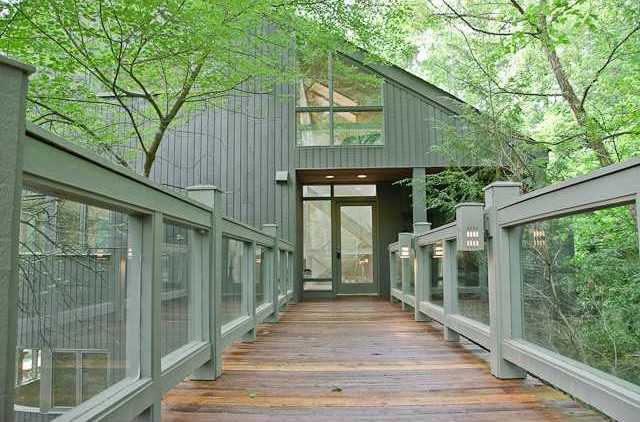

```{r}
#| label: setup
#| include: false

ggplot2::theme_set(ggplot2::theme_gray(base_size = 18))
#ggplot2::theme_set(ggplot2::theme_bw(base_size = 24))
todays_ae <- "ae-13-duke-forest-bootstrap"
```

# Quantifying uncertainty

## Goal

Find range of plausible values for the slope using bootstrap confidence intervals.

## Packages

```{r}
#| label: packages
#| echo: true
#| message: false
# load packages
library(tidyverse) # for data wrangling and visualization
library(tidymodels) # for modeling
library(openintro) # for Duke Forest dataset
library(scales) # for pretty axis labels
library(glue) # for constructing character strings
library(knitr) # for neatly formatted tables
```

## Data: Houses in Duke Forest {.smaller}

::::: columns
::: {.column width="50%"}
-   Data on houses that were sold in the Duke Forest neighborhood of Durham, NC around November 2020
-   Scraped from Zillow
-   Source: [`openintro::duke_forest`](http://openintrostat.github.io/openintro/reference/duke_forest.html)
:::

::: {.column width="50%"}
{fig-alt="Home in Duke Forest"}
:::
:::::

**Goal**: Use the area (in square feet) to understand variability in the price of houses in Duke Forest.

## Exploratory data analysis

```{r}
#| code-fold: true
ggplot(duke_forest, aes(x = area, y = price)) +
  geom_point(alpha = 0.7) +
  labs(
    x = "Area (square feet)",
    y = "Sale price (USD)",
    title = "Price and area of houses in Duke Forest"
  ) +
  scale_y_continuous(labels = label_dollar())
```

## Modeling {.smaller}

```{r}
df_fit <- linear_reg() |>
  fit(price ~ area, data = duke_forest)

tidy(df_fit) |>
  kable(digits = 2) # neatly format table to 2 digits
```

```{r}
#| echo: false
intercept <- tidy(df_fit) |>
  filter(term == "(Intercept)") |>
  pull(estimate) |>
  round()
slope <- tidy(df_fit) |> filter(term == "area") |> pull(estimate) |> round()
```

## Participate {.xsmall}

Which of the following is the correct interpretation of the **intercept**?

```{r}
#| echo: false
tidy(df_fit) |>
  kable(digits = 0)
```


a. For each additional square foot, the model predicts the sale price of Duke Forest houses to be higher by `r dollar(intercept)`, on average.
b. Duke Forest houses that are 0 square feet are predicted to sell, for `r dollar(intercept)`, on average.
c. For each additional square foot, the model predicts the sale price of Duke Forest houses to be lower by `r dollar(slope*100)`, on average.
d. Duke Forest houses that are 0 square feet are predicted to sell, for `r dollar(slope*100)`, on average.

## Participate {.xsmall}

Which of the following is the correct interpretation of the **slope**?

```{r}
#| echo: false
tidy(df_fit) |>
  kable(digits = 0)
```

a. For each additional square foot, the model predicts the sale price of Duke Forest houses to be higher by `r dollar(slope)`, on average.
b. Duke Forest houses that are 0 square feet are predicted to sell, for `r dollar(intercept)`, on average.
c. For each additional square foot, the model predicts the sale price of Duke Forest houses to be lower by `r dollar(slope*100)`, on average.
d. Duke Forest houses that are 0 square feet are predicted to sell, for `r dollar(slope)`, on average.

## From sample to population {.smaller}

> For each additional square foot, we expect the sale price of Duke Forest houses to be higher by `r dollar(slope)`, on average.

<br>

-   This estimate is valid for the single sample of `r nrow(duke_forest)` houses.
-   But what if we're not interested quantifying the relationship between the size and price of a house in this single sample?
-   What if we want to say something about the relationship between these variables for all houses in Duke Forest?

## Statistical inference {.smaller}

-   **Statistical inference** provide methods and tools so we can use the single observed sample to make valid statements (inferences) about the population it comes from

-   For our inferences to be valid, the sample should be random and representative of the population we're interested in

{fig-alt="Soup in a bowl"}

## Inference for simple linear regression

-   Calculate a confidence interval for the slope, $\beta_1$ (today)

-   Conduct a hypothesis test for the slope,$\beta_1$ (next week)

# Confidence interval for the slope

## Confidence interval {.smaller}

::: incremental
-   A plausible range of values for a population parameter is called a **confidence interval**
-   Using only a single point estimate is like fishing in a murky lake with a spear, and using a confidence interval is like fishing with a net
    -   We can throw a spear where we saw a fish but we will probably miss, if we toss a net in that area, we have a good chance of catching the fish
    -   Similarly, if we report a point estimate, we probably will not hit the exact population parameter, but if we report a range of plausible values we have a good shot at capturing the parameter
:::

## Confidence interval for the slope {.smaller}

A confidence interval will allow us to make a statement like "*For each additional square foot, the model predicts the sale price of Duke Forest houses to be higher, on average, by `r dollar(slope)`, plus or minus X dollars.*"

. . .

-   Should X be \$10?
    \$100?
    \$1000?

-   If we were to take another sample of `r nrow(duke_forest)` would we expect the slope calculated based on that sample to be exactly `r dollar(slope)`?
    Off by \$10?
    \$100?
    \$1000?

-   The answer depends on how variable (from one sample to another sample) the sample statistic (the slope) is

-   We need a way to quantify the variability of the sample statistic

## Quantify the variability of the slope {.smaller}

**for estimation**

::: incremental
-   Two approaches:
    1.  Via simulation (what we'll do in this course)
    2.  Via mathematical models (what you can learn about in future courses)
-   **Bootstrapping** to quantify the variability of the slope for the purpose of estimation:
    -   Bootstrap new samples from the original sample
    -   Fit models to each of the samples and estimate the slope
    -   Use features of the distribution of the bootstrapped slopes to construct a confidence interval
:::

```{r}
#| echo: false
set.seed(119)

df_boot_samples_5 <- duke_forest |>
  specify(price ~ area) |>
  generate(reps = 5, type = "bootstrap")
```

## Bootstrap sample 1

::::: columns
::: {.column width="50%"}

```{r}
#| echo: false
#| out-width: "100%"
#| message: false
p_df_obs <- ggplot(duke_forest, aes(x = area, y = price)) +
  geom_point() +
  geom_smooth(method = "lm", se = FALSE, color = "#8F2D56") +
  labs(
    x = "Area (square feet)",
    y = "Sale price (USD)",
    title = "Price and area of houses in Duke Forest"
  ) +
  scale_y_continuous(limits = c(90000, 1550000), labels = label_dollar()) +
  scale_x_continuous(limits = c(1000, 6500), labels = label_number())

p_df_obs
```

:::

::: {.column width="50%"}

```{r}
#| echo: false
#| out-width: "100%"
#| message: false
replicate_no = 1

ggplot(
  df_boot_samples_5 |> filter(replicate == replicate_no),
  aes(x = area, y = price)
) +
  geom_point(alpha = 0.5) +
  geom_line(stat = "smooth", method = "lm", se = FALSE, alpha = 0.8) +
  labs(
    x = "Area (square feet)",
    y = "Sale price (USD)",
    title = glue("Bootstrap sample {replicate_no}")
  ) +
  scale_y_continuous(limits = c(90000, 1550000), labels = label_dollar()) +
  scale_x_continuous(limits = c(1000, 6500), labels = label_number())
```

:::
:::::

## Bootstrap sample 2

::::: columns
::: {.column width="50%"}

```{r}
#| echo: false
#| out-width: "100%"
#| message: false
p_df_obs
```

:::

::: {.column width="50%"}

```{r}
#| echo: false
#| out-width: "100%"
#| message: false
replicate_no = 2

ggplot(
  df_boot_samples_5 |> filter(replicate == replicate_no),
  aes(x = area, y = price)
) +
  geom_point(alpha = 0.5) +
  geom_line(stat = "smooth", method = "lm", se = FALSE, alpha = 0.8) +
  labs(
    x = "Area (square feet)",
    y = "Sale price (USD)",
    title = glue("Bootstrap sample {replicate_no}")
  ) +
  scale_y_continuous(limits = c(90000, 1550000), labels = label_dollar()) +
  scale_x_continuous(limits = c(1000, 6500), labels = label_number())
```

:::
:::::

## Bootstrap sample 3

::::: columns
::: {.column width="50%"}

```{r}
#| echo: false
#| out-width: "100%"
#| message: false
p_df_obs
```

:::

::: {.column width="50%"}

```{r}
#| echo: false
#| out-width: "100%"
#| message: false
replicate_no = 3

ggplot(
  df_boot_samples_5 |> filter(replicate == replicate_no),
  aes(x = area, y = price)
) +
  geom_point(alpha = 0.5) +
  geom_line(stat = "smooth", method = "lm", se = FALSE, alpha = 0.8) +
  labs(
    x = "Area (square feet)",
    y = "Sale price (USD)",
    title = glue("Bootstrap sample {replicate_no}")
  ) +
  scale_y_continuous(limits = c(90000, 1550000), labels = label_dollar()) +
  scale_x_continuous(limits = c(1000, 6500), labels = label_number())
```

:::
:::::

## Bootstrap sample 4

::::: columns
::: {.column width="50%"}

```{r}
#| echo: false
#| out-width: "100%"
#| message: false
p_df_obs
```

:::

::: {.column width="50%"}

```{r}
#| echo: false
#| out-width: "100%"
#| message: false
replicate_no = 4

ggplot(
  df_boot_samples_5 |> filter(replicate == replicate_no),
  aes(x = area, y = price)
) +
  geom_point(alpha = 0.5) +
  geom_line(stat = "smooth", method = "lm", se = FALSE, alpha = 0.8) +
  labs(
    x = "Area (square feet)",
    y = "Sale price (USD)",
    title = glue("Bootstrap sample {replicate_no}")
  ) +
  scale_y_continuous(limits = c(90000, 1550000), labels = label_dollar()) +
  scale_x_continuous(limits = c(1000, 6500), labels = label_number())
```

:::
:::::

## Bootstrap sample 5

::::: columns
::: {.column width="50%"}

```{r}
#| echo: false
#| out-width: "100%"
#| message: false
p_df_obs
```

:::

::: {.column width="50%"}

```{r}
#| echo: false
#| out-width: "100%"
#| message: false
replicate_no = 5

ggplot(
  df_boot_samples_5 |> filter(replicate == replicate_no),
  aes(x = area, y = price)
) +
  geom_point(alpha = 0.5) +
  geom_line(stat = "smooth", method = "lm", se = FALSE, alpha = 0.8) +
  labs(
    x = "Area (square feet)",
    y = "Sale price (USD)",
    title = glue("Bootstrap sample {replicate_no}")
  ) +
  scale_y_continuous(limits = c(90000, 1550000), labels = label_dollar()) +
  scale_x_continuous(limits = c(1000, 6500), labels = label_number())
```

:::
:::::

. . .

*so on and so forth...*

## Bootstrap samples 1 - 5

::::: columns
::: {.column width="50%"}

```{r}
#| echo: false
#| out-width: "100%"
#| message: false
p_df_obs
```

:::

::: {.column width="50%"}

```{r}
#| echo: false
#| out-width: "100%"
#| message: false
ggplot(df_boot_samples_5, aes(x = area, y = price, group = replicate)) +
  geom_line(stat = "smooth", method = "lm", se = FALSE, alpha = 0.5) +
  labs(
    x = "Area (square feet)",
    y = "Sale price (USD)",
    title = glue("Bootstrap samples 1 - 5")
  ) +
  scale_y_continuous(limits = c(90000, 1550000), labels = label_dollar()) +
  scale_x_continuous(limits = c(1000, 6500), labels = label_number())
```

:::
:::::

## Bootstrap samples 1 - 100

```{r}
#| echo: false
#| message: false
set.seed(119)

df_boot_samples_100 <- duke_forest |>
  specify(price ~ area) |>
  generate(reps = 100, type = "bootstrap")
```

::::: columns
::: {.column width="50%"}

```{r}
#| echo: false
#| out-width: "100%"
#| message: false
p_df_obs
```

:::

::: {.column width="50%"}

```{r}
#| echo: false
#| out-width: "100%"
#| message: false
p_df_boot_samples_100 <- ggplot(
  df_boot_samples_100,
  aes(x = area, y = price, group = replicate)
) +
  geom_line(stat = "smooth", method = "lm", se = FALSE, alpha = 0.05) +
  labs(
    x = "Area (square feet)",
    y = "Sale price (USD)",
    title = glue("Bootstrap samples 1 - 100")
  ) +
  scale_y_continuous(limits = c(90000, 1550000), labels = label_dollar()) +
  scale_x_continuous(limits = c(1000, 6500), labels = label_number())

p_df_boot_samples_100
```

:::
:::::

. . .

::: question
Look familiar?
:::

## Look familiar?

::::: columns
::: {.column width="50%"}

```{r}
#| echo: false
#| message: false
p_df_boot_samples_100
```

:::

::: {.column width="50%"}

```{r}
#| echo: false
#| message: false
ggplot(duke_forest, aes(x = area, y = price)) +
  geom_point() +
  geom_smooth(method = "lm", se = TRUE) +
  labs(
    x = "Area (square feet)",
    y = "Sale price (USD)",
    title = "Price and area of houses in Duke Forest"
  ) +
  scale_y_continuous(limits = c(90000, 1550000), labels = label_dollar()) +
  scale_x_continuous(limits = c(1000, 6500), labels = label_number())
```

:::
:::::


## Slopes of bootstrap samples {.smaller}

::: task
**Fill in the blank:** For each additional square foot, the model predicts the sale price of Duke Forest houses to be higher, on average, by `r dollar(slope)`, plus or minus \_\_\_ dollars.
:::

```{r}
#| echo: false
#| message: false
p_df_boot_samples_100 +
  geom_abline(intercept = intercept, slope = slope, color = "#8F2D56")
```

## Slopes of bootstrap samples {.smaller}

::: task
**Fill in the blank:** For each additional square foot, we expect the sale price of Duke Forest houses to be higher, on average, by `r dollar(slope)`, plus or minus \_\_\_ dollars.
:::

```{r}
#| echo: false
df_boot_samples_100_fit <- df_boot_samples_100 |>
  fit()

df_boot_samples_100_hist <- ggplot(
  df_boot_samples_100_fit |> filter(term == "area"),
  aes(x = estimate)
) +
  geom_histogram(binwidth = 10, color = "white") +
  geom_vline(xintercept = slope, color = "#8F2D56", linewidth = 1) +
  labs(x = "Slope", y = "Count", title = "Slopes of 100 bootstrap samples") +
  scale_x_continuous(labels = label_dollar())

df_boot_samples_100_hist
```

## Confidence level {.smaller}

::: task
How confident are you that the true slope is between \$0 and \$250?
How about \$150 and \$170?
How about \$90 and \$210?
:::

```{r}
#| echo: false
df_boot_samples_100_hist
```

## 95% confidence interval {.smaller}

```{r}
#| echo: false
lower <- df_boot_samples_100_fit |>
  ungroup() |>
  filter(term == "area") |>
  summarise(quantile(estimate, 0.025)) |>
  pull()

upper <- df_boot_samples_100_fit |>
  ungroup() |>
  filter(term == "area") |>
  summarise(quantile(estimate, 0.975)) |>
  pull()

df_boot_samples_100_hist +
  geom_vline(
    xintercept = lower,
    color = "steelblue",
    linewidth = 1,
    linetype = "dashed"
  ) +
  geom_vline(
    xintercept = upper,
    color = "steelblue",
    linewidth = 1,
    linetype = "dashed"
  )
```

::: incremental
-   A 95% confidence interval is bounded by the middle 95% of the bootstrap distribution
-   We are 95% confident that for each additional square foot, the model predicts the sale price of Duke Forest houses to be higher, on average, by `r dollar(lower)` to `r dollar(upper)`.
:::

# Application exercise

## `{r} todays_ae` {.smaller}

::: appex
-   Go to your ae project in RStudio.

-   If you haven't yet done so, make sure all of your changes up to this point are committed and pushed, i.e., there's nothing left in your Git pane.

-   If you haven't yet done so, click Pull to get today's application exercise file: *`{r} paste0(todays_ae, ".qmd")`*.

-   Work through the application exercise in class, and render, commit, and push your edits.
:::
