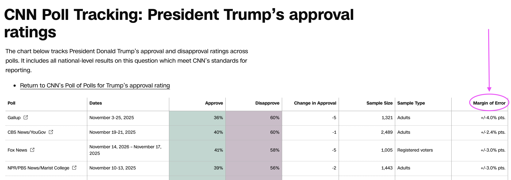

```{r}
#| label: setup
#| include: false
ggplot2::theme_set(ggplot2::theme_gray(base_size = 18))
```

# From last time

## Participate {.xsmall}

Which of the following is true about confidence intervals?

a) They're for a sample statistic.
b) They're for a population parameter.
c) They can be either for both a sample statistic or a population parameter.
d) They're neither for a sample statistic nor a population parameter.

## Why do we construct confidence intervals?

To estimate plausible values of a parameter of interest, e.g., 

- a slope ($\beta_1$)
- a mean ($\mu$)
- a proportion ($p$)
- etc.

## What is bootstrapping?

-   Bootstrapping is a statistical procedure that resamples(with replacement) a single data set to create many simulated samples.

-   We then use these simulated samples to quantify the uncertainty around the sample statistic we're interested in, e.g., a slope ($b_1$), a mean ($\bar{x}$), a proportion ($\hat{p}$).

## Setup

```{r}
#| message: false
library(tidyverse)
library(tidymodels)
library(openintro)
```

## Computing the CI for the slope I

Calculate the observed slope:

```{r}
#| echo: true
observed_fit <- duke_forest |>
  specify(price ~ area) |>
  fit()

observed_fit
```

## Computing the CI for the slope II {.smaller}

Take `1000` bootstrap samples and fit models to each one:

```{r}
#| code-line-numbers: "1,5,6"
set.seed(1120)

boot_fits <- duke_forest |>
  specify(price ~ area) |>
  generate(reps = 1000, type = "bootstrap") |>
  fit()

boot_fits
```

## What does each observation on the plot represent? {.smaller}

::: {.columns}

::: {.column}
-   Resample, with replacement, from the original data
-   Do this `reps = 1000` times
-   Calculate the summary statistic of interest in each of these samples
:::

::: {.column}
```{r}
#| echo: false
#| fig-asp: 1
visualize(boot_fits)
```
:::

:::

## Computing the CI for the slope III

**Percentile method:** Compute the 95% CI as the middle 95% of the bootstrap distribution:

```{r}
#| code-line-numbers: "5"
get_confidence_interval(
  boot_fits,
  point_estimate = observed_fit,
  level = 0.95,
  type = "percentile" # default method
)
```

## Participate {.xsmall}

If you want to be very certain (i.e., more confident) that you capture the population parameter, should we use a wider or a narrower interval?

a) Wider 
b) Narrower
c) Depends on the situation

## Precision vs. accuracy {.smaller}

::: task
What drawbacks are associated with using a wider interval?
:::

. . .


## Precision vs. accuracy {.smaller}

::: task
How can we get best of both worlds -- high precision and high accuracy?
:::

## Recap {.xsmall}

::: incremental

-   **Population:** Complete set of observations of whatever we are studying, e.g., people, tweets, photographs, etc. -- population size = $N$

-   **Sample:** Subset of the population, ideally random and representative -- sample size = $n$

-   Sample statistic $\ne$ population parameter, but if the sample is good, it can be a good estimate

-   **Statistical inference:** Discipline that concerns itself with the development of procedures, methods, and theorems that allow us to extract meaning and information from data that has been generated by stochastic (random) process

-   We report the estimate with a confidence interval, and the width of this interval depends on the variability of sample statistics from different samples from the population

-   Since we can't continue sampling from the population, we bootstrap from the one sample we have to estimate sampling variability

:::

## An alternative approach

**Standard error method:** Compute the 95% CI as the observed slope plus/minus ~2 * standard error (the standard deviation of the bootstrap distribution):

```{r}
#| code-line-numbers: "5"
#| output-location: column
get_confidence_interval(
  boot_fits,
  point_estimate = observed_fit,
  level = 0.95,
  type = "se"
)
```

## Margin of error

That quantity (~2 * standard error) is called the **margin of error**, e.g.,

{width="700px}

::: aside
Source: <https://www.cnn.com/polling/approval/trump-polls>
:::

## On the horizon... {.smaller}

::: incremental
-   In this class you learned how to construct a confidence interval (i.e., calculate the margin of error) using a computational method called bootstrapping.

-   The bootstrap distributions you constructed (given enough `reps` -- repeated samples) were unimodal and symmetric around the observed statistic.

-   This is not a happenstance! And there is theory behind it... It's called the **Central Limit Theorem**!

-   You can learn about the Central Limit Theorem and theory-based methods for constructing confidence intervals (and other inference procedures) in future stats courses.
:::

# Hypothesis testing

## Hypothesis testing {.smaller}

A hypothesis test is a statistical technique used to evaluate *competing claims* using data

::: incremental
-   **Null hypothesis,** $H_0$: An assumption about the population.
    "There is nothing going on."

-   **Alternative hypothesis,** $H_A$: A research question about the population.
    "There is something going on".
:::

. . .

::: callout-note
Hypotheses are always at the population level!
:::

## Setting hypotheses

-   **Null hypothesis,** $H_0$: "There is nothing going on." The slope of the model for predicting the prices of houses in Duke Forest from their areas is 0, $\beta_1 = 0$.

-   **Alternative hypothesis,** $H_A$: "There is something going on".
    The slope of the model for predicting the prices of houses in Duke Forest from their areas is different than 0, $\beta_1 \ne 0$.

## Hypothesis testing "mindset"

-   Assume you live in a world where the null hypothesis is true: $\beta_1 = 0$.

-   Ask yourself how likely you are to observe the sample statistic, or something even more extreme, in this world: 

$$P \big( b_1 \leq -159~or~b_1 \geq 159 ~|~ \beta_1 = 0 \big)$$

## Hypothesis testing as a court trial {.smaller}

-   **Null hypothesis**, $H_0$: Defendant is innocent

-   **Alternative hypothesis**, $H_A$: Defendant is guilty

. . .

- **Assume the null hypothesis** is true (i.e. Defendant is innocent until proven guilty
)

. . .

-   **Present the evidence:** Collect data

. . .

-   **Judge the evidence:** "Could these data plausibly have happened by chance if the null hypothesis were true?"
    -   Yes: Fail to reject $H_0$ (i.e. Defendant is *not found guilty*. Different than *innocent*!)
    -   No: Reject $H_0$ (i.e. Defendant is found guilty.)
    
## Hypothesis testing framework {.smaller}

::: incremental
-   Start with a null hypothesis, $H_0$, that represents the status quo

-   Set an alternative hypothesis, $H_A$, that represents the research question, i.e. what we’re testing for

-   Conduct a hypothesis test under the assumption that the null hypothesis is true and calculate a **p-value** (probability of observed or more extreme outcome given that the null hypothesis is true)

    -   if the test results suggest that the data do not provide convincing evidence for the alternative hypothesis, stick with the null hypothesis
    -   if they do, then reject the null hypothesis in favor of the alternative
    -   Small enough p-value $\to$ Reject the null hypothesis
    -   Larger p-value $\to$ Fail to reject the null hypothesis
:::

## Calculate observed slope

...
which we have already done:

```{r}
observed_fit <- duke_forest |>
  specify(price ~ area) |>
  fit()

observed_fit
```

## Simulate null distribution

```{r}
set.seed(20261123)
null_dist <- duke_forest |>
  specify(price ~ area) |>
  hypothesize(null = "independence") |>
  generate(reps = 1000, type = "permute") |>
  fit()
```

## View null distribution {.smaller}

```{r}
null_dist
```

## Visualize null distribution {.smaller}

```{r}
#| fig-asp: 1
visualize(null_dist)
```

## Visualize null distribution + p-value

```{r}
#| fig-asp: 1
#| output-location: column
visualize(null_dist) +
  shade_p_value(
    obs_stat = observed_fit, 
    direction = "two-sided"
  )
```

## Get p-value {.smaller}

```{r}
null_dist |>
  get_p_value(obs_stat = observed_fit, direction = "two-sided")
```

## Make a decision

::: task
Based on the p-value calculated, what is the conclusion of the hypothesis test?
:::

. . .

Since the p-value is sufficiently small, we have strong evidence to **reject the null hypothesis** that the slope of the model for predicting the prices of houses in Duke Forest from their areas is 0.

In other words, we have strong evidence that the true slope is **not** zero.
